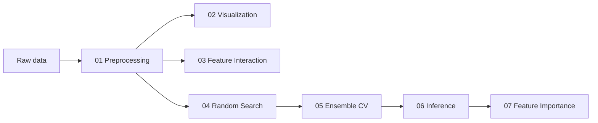
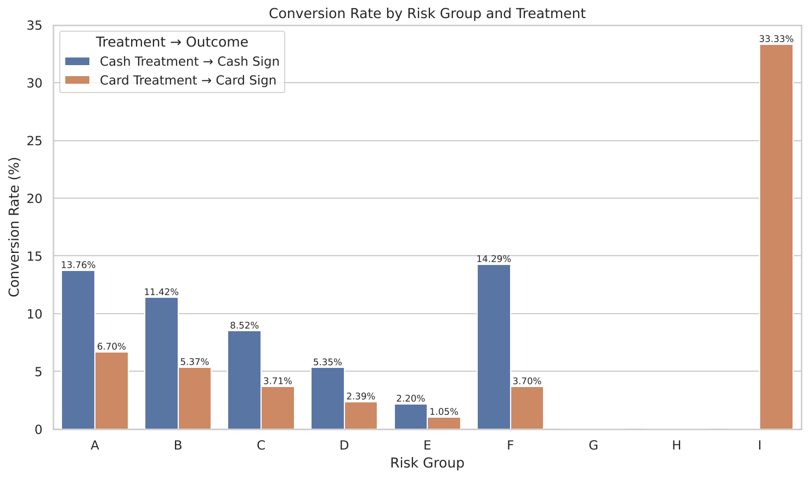
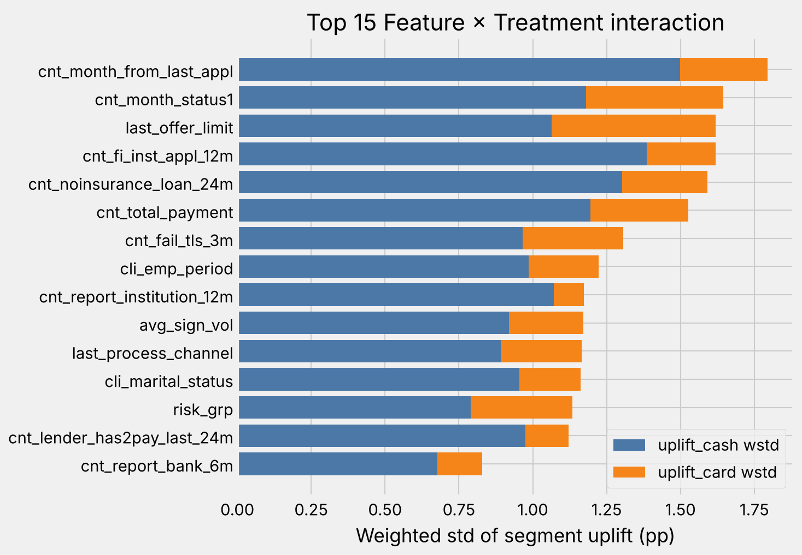
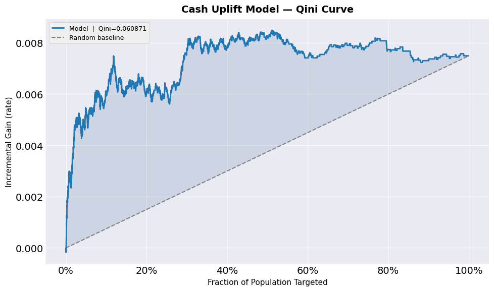
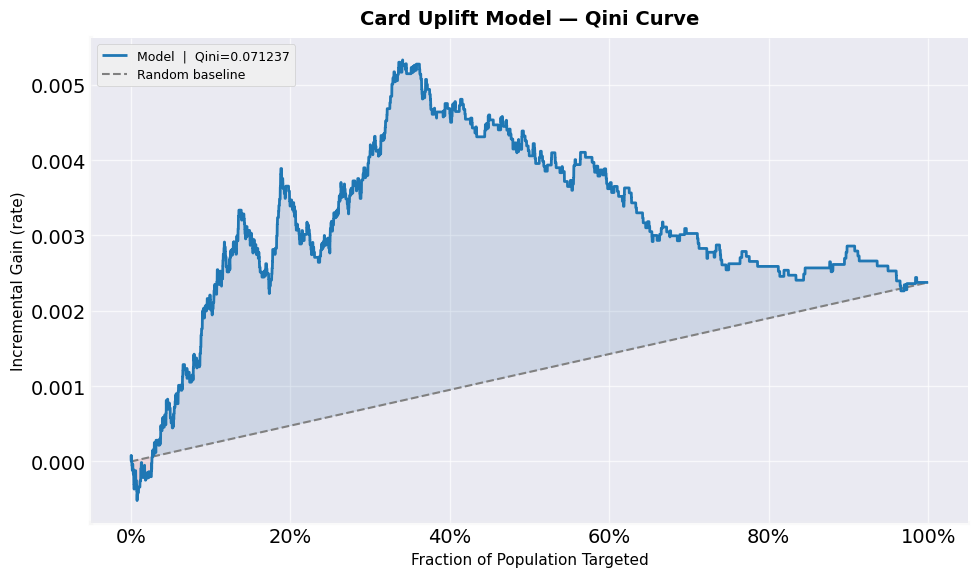
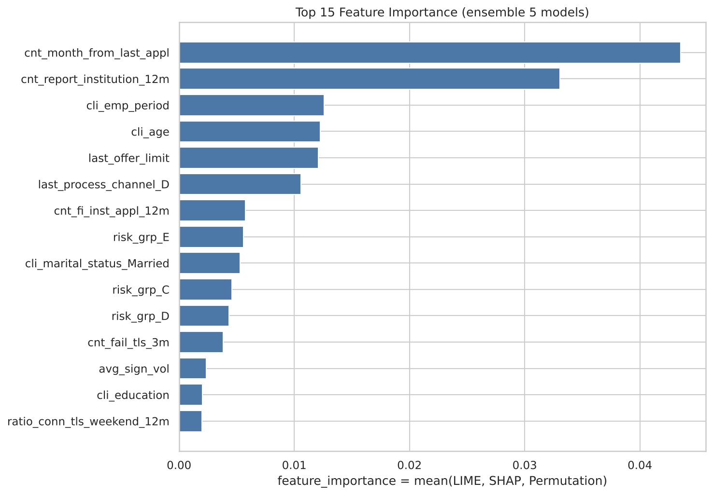

# DAZONE 2026 Round 3.1 - Home Credit Uplift Modelling

Mã nguồn và kết quả của nhóm ở vòng 3.1 DAZONE 2026, với bài toán do Home Credit đưa ra: nên ưu tiên giới thiệu Cash Loan hay Credit Card cho từng khách hàng? Mục tiêu là chọn chiến lược truyền thông dựa trên tác động tăng thêm đến khả năng chuyển đổi, thay vì chỉ dự đoán khách hàng nào có khả năng đăng ký sản phẩm.

Nhóm thử nhiều phương pháp uplift và chọn ensemble gồm 3 cấu hình UPLIFT_RF_CIT và 2 cấu hình INT_RF. Kết quả 5-fold cross-validation của ensemble đạt Qini_total trung bình 0.094930 (Qini_cash 0.057631, Qini_card 0.037299).

## 1. Bài toán và cách đánh giá

| Thành phần | Định nghĩa |
|---|---|
| Treatment | Chiến lược truyền thông được phân bổ ngẫu nhiên: `cash` hoặc `card` |
| Outcome | `cash_sign_30d` (ký Cash Loan), `card_sign_30d` (mở Credit Card), không hủy trong 30 ngày sau treatment |
| Uplift Cash | `P(cash_sign_30d = 1 \| Cash, x) - P(cash_sign_30d = 1 \| Card, x)` |
| Uplift Card | `P(card_sign_30d = 1 \| Card, x) - P(card_sign_30d = 1 \| Cash, x)` |
| Metric | `Qini_total = Qini_cash + Qini_card` |

### Qini coefficient

Với mỗi target, nhóm sắp xếp khách hàng theo uplift dự đoán giảm dần. Tại tỷ lệ khách hàng $\phi = k/N$:

$$Q(\phi) = \frac{\sum_{i \le k} y_i\, w_i}{N_{treatment}} - \frac{\sum_{i \le k} y_i\,(1-w_i)}{N_{control}}$$

$$AUC_{random} = \frac{Q(1)}{2}, \qquad \text{Qini}_{coef} = \frac{AUC_{model} - AUC_{random}}{AUC_{perfect} - AUC_{random}}$$

AUC được tính bằng quy tắc hình thang trên đường `(φ, Q(φ))`. Khi đánh giá target Cash, `w = 1` là nhóm nhận Cash; với target Card, `w = 1` là nhóm nhận Card. `AUC_perfect` được tính từ cách xếp hạng lý tưởng với điểm `w·y - (1-w)·y`.

Đề bài dùng phần chênh `AUC_model - AUC_random`. Trong code của nhóm, phần chênh này được chia thêm cho `AUC_perfect - AUC_random` để chuẩn hóa hai target trước khi cộng, nên các số Qini bên dưới là điểm theo cách tính này.

## 2. Dữ liệu

| Tập | Số dòng | Số cột | Ghi chú |
|---|---:|---:|---|
| `data/raw/dazone_sample.csv` | 136,992 | 44 | `customer_id`, `treatment`, 2 target, 40 feature |
| `data/raw/dazone_sample_test.csv` | 34,080 | 44 | Đã ẩn nhãn |

| Treatment | Khách hàng | Tỷ trọng |
|---|---:|---:|
| Cash | 75,612 | 55.19% |
| Card | 61,380 | 44.81% |

| Target | Số dương | Tỷ lệ |
|---|---:|---:|
| `cash_sign_30d` | 8,108 | 5.92% |
| `card_sign_30d` | 3,714 | 2.71% |
| Không chuyển đổi | | 91.82% |

Tỷ lệ chuyển đổi theo treatment (%):

| | Cash Sign | Card Sign |
|---|---:|---:|
| Cash Treatment | 6.26 | 2.61 |
| Card Treatment | 5.50 | 2.84 |
| Chênh lệch (ATE) | +0.76 pp | +0.24 pp |

Tính trên toàn bộ mẫu, nhóm nhận thông điệp Cash có tỷ lệ ký Cash cao hơn 0.76 điểm phần trăm; nhóm nhận thông điệp Card có tỷ lệ mở thẻ cao hơn 0.24 điểm phần trăm. Mức chênh trung bình này chưa cho biết khách hàng nào phù hợp hơn với từng chiến lược. Đây là phần nhóm giải quyết bằng uplift modeling.

## 3. Quy trình thực hiện



| Bước | Notebook | Đầu ra |
|---|---|---|
| Tiền xử lý | [01_data_preprocessing](notebooks/01_data_preprocessing.ipynb) | `df_feature.csv`, `df_target.csv`, `test_df_feature.csv`, `transformers.joblib` |
| Khảo sát dữ liệu | [02_visualization_business_insight](notebooks/02_visualization_business_insight.ipynb) | Biểu đồ EDA theo phân khúc |
| Tương tác đặc trưng | [03_feature_interaction](notebooks/03_feature_interaction.ipynb) | Correlation, uplift theo phân khúc |
| Tìm siêu tham số | [04_uplift_random_search](notebooks/04_uplift_random_search.ipynb) | `results/random_search_*.csv` |
| Đánh giá ensemble | [05_ensemble_cross_validation](notebooks/05_ensemble_cross_validation.ipynb) | `results/ensemble_cv_qini.csv`, Qini curve |
| Dự đoán test | [06_inference_test](notebooks/06_inference_test.ipynb) | Xác suất, uplift, chiến lược khuyến nghị |
| Phân tích đặc trưng | [07_feature_importance](notebooks/07_feature_importance.ipynb) | `feature_importance.csv` |

## 4. Tiền xử lý dữ liệu

Nhóm bỏ `customer_id` và 6 cột có tỷ lệ thiếu trên 50%:

| Cột | Missing |
|---|---:|
| `cnt_month_from_first_transaction` | 93.60% |
| `cnt_month_from_last_transaction` | 93.60% |
| `ratio_vol_hcvn_cash_appl_12m` | 89.47% |
| `ratio_monthly_amt_l6m_vs_n6m` | 82.55% |
| `max_cntr_len_fi_12m` | 74.07% |
| `f_appointment_3m` | 55.70% |

Phần xử lý được fit trên tập train rồi áp dụng lại cho tập test:

| Nhóm | Số cột | Xử lý |
|---|---:|---|
| Số liên tục | 15 | `SimpleImputer(median)`, `MinMaxScaler` |
| Số rời rạc, flag | 12 | `SimpleImputer(most_frequent)`, `MinMaxScaler` |
| Nominal | 7 | `SimpleImputer(most_frequent)`, `OneHotEncoder(drop="first")`, ra 35 cột (gồm `treatment_cash`) |
| Ordinal `cli_education` | 1 | `SimpleImputer(most_frequent)`, `OrdinalEncoder` theo thứ tự ELEMENTARY_SCHOOL, PTCS, PTTH, BACHELORS, MASTERS, `MinMaxScaler` |

Sau tiền xử lý, `df_feature` có 136,992 dòng và 63 cột (62 feature trên khoảng [0, 1] và `treatment_cash`). `df_target` gồm `cash_sign_30d` và `card_sign_30d`.

## 5. Khảo sát dữ liệu theo phân khúc

Ở phần EDA, nhóm đặt tỷ lệ ký Cash trong nhóm nhận Cash cạnh tỷ lệ mở thẻ trong nhóm nhận Card. `cash_minus_card` là chênh lệch giữa hai tỷ lệ chuyển đổi của hai target khác nhau, tính theo điểm phần trăm; đây không phải uplift của một target.


| Phân khúc | Quan sát | Số liệu |
|---|---|---|
| Risk group | Nhóm rủi ro cao có tỷ lệ chuyển đổi thấp hơn ở cả hai sản phẩm | A: Cash 13.76%, Card 6.70%; E: Cash 2.20%, Card 1.05% |
| Số lần thanh toán | Tỷ lệ chuyển đổi tăng theo decile | Cash 1.51% (D1) lên 18.11% (D10); Card 0.99% lên 5.93% |
| Tất toán khoản vay 12 tháng | Tỷ lệ ký Cash cao hơn ở nhóm tất toán nhiều khoản | Cash 7.46% (0 khoản), 26.35% (4 khoản trở lên, n = 260) |
| Hạn mức offer | Decile cao nhất có tỷ lệ chuyển đổi cao nhất | D10: Cash 13.04%, Card 6.30% |
| Học vấn | Chênh lệch Cash - Card thấp hơn ở nhóm học vấn cao | `cash_minus_card` PTTH 4.03, MASTERS 1.98; Card ở MASTERS 4.78% |
| Tuổi | Nhóm dưới 25 tuổi có tỷ lệ mở Card cao nhất | Card 4.47%; nhóm 55+ có chênh lệch lớn nhất 6.60 |
| Worst credit status | Nhóm status 3 có tỷ lệ mở Card cao hơn ký Cash | Cash 1.01%, Card 1.39% (n = 171) |
| Đặt lịch hẹn 3 tháng | Tỷ lệ ký Cash cao nhưng cỡ mẫu nhỏ | Cash 48.28%, Card 4.00% (54 khách) |
| Telesales kết nối | Tỷ lệ ký Cash tăng tới D5 rồi dao động | Cash 4.99% (D1), 6.93% (D5), sau đó 6.03% đến 6.61% |

 

Các nhóm rủi ro F, G, H, I chỉ có lần lượt 69, 13, 5 và 4 khách; nhóm không dùng các nhóm này để rút ra xu hướng.

## 6. Tương tác giữa đặc trưng và treatment

### 6.1 Tương quan giữa các đặc trưng (|corr| ≥ 0.7)

| Feature 1 | Feature 2 | corr |
|---|---|---:|
| `cnt_month_from_first_transaction` | `cnt_month_from_last_transaction` | 0.84 |
| `min_sign_vol` | `avg_sign_vol` | 0.75 |
| `cnt_month_from_last_appl` | `cnt_month_from_first_transaction` | 0.73 |
| `cnt_month_from_last_appl` | `cnt_month_from_last_transaction` | 0.71 |

### 6.2 Uplift theo phân khúc

Do treatment được phân bổ ngẫu nhiên, nhóm ước lượng uplift trong mỗi phân khúc bằng chênh lệch tỷ lệ chuyển đổi giữa hai nhóm treatment. Để xem uplift thay đổi theo feature nào, nhóm chia feature thành các bin và tính độ lệch chuẩn có trọng số của uplift giữa các bin. Các bin có dưới 200 khách ở một trong hai nhóm không được đưa vào phép so sánh.



| Phân khúc | `uplift_cash` (pp) | `uplift_card` (pp) |
|---|---:|---:|
| `cnt_month_from_last_appl` ≤ 6 tháng | +4.43 | +0.74 |
| `cnt_month_from_last_appl` 6 đến 19 tháng | +2.03 / +2.03 | +0.33 / -0.02 |
| `cnt_month_from_last_appl` > 28 tháng | -0.52 đến +0.18 | -0.09 đến +0.49 |
| `risk_grp` A / B | +2.42 / +2.30 | +1.07 / +0.66 |
| `risk_grp` E | -0.07 | -0.04 |
| `cnt_total_payment` D9 / D10 | +2.79 / +3.39 | +0.35 / +0.85 |
| `cnt_total_payment` D1 đến D6 | -0.22 đến +0.38 | -0.12 đến +0.28 |

Uplift Cash ước lượng cao hơn ở khách vừa nộp hồ sơ, nhóm rủi ro A/B và nhóm có nhiều lần thanh toán. Với nhóm E hoặc khách đã lâu không nộp hồ sơ, uplift Cash gần 0 trong các phân khúc được khảo sát. `cnt_month_from_last_appl` cũng đứng đầu bảng feature importance ở mục 8.


### 6.3 Đầu vào của INT_RF

$$X_{aug} = [\,X,\; W,\; X \cdot W\,] \in \mathbb{R}^{n \times 125}, \qquad \text{uplift}(x) = \hat P(y=1 \mid x, W=1) - \hat P(y=1 \mid x, W=0)$$

## 7. Huấn luyện và chọn mô hình

### 7.1 Sàng lọc mô hình

| Meta-learner | Base model | Direct uplift (tree) | Direct uplift (forest) |
|---|---|---|---|
| T, S, INT, CT, TO, X, R, DR | dt, rf, extratrees, adaboost, lgbm, xgb, cat, hgb, logistic, knn, fuzzy_knn, svm, mlp, kan, deep_kan | UPLIFT_TREE_{KL, ED, CHI, CTS, DDP}, INTERACTION_TREE, CAUSAL_INFERENCE_TREE | UPLIFT_RF_{KL, ED, CHI, CTS, DDP, IT, CIT}, UTBOOST |

Nhóm đánh giá các tổ hợp meta-learner, base model và mô hình uplift trực tiếp bằng K-fold CV. Bảng dưới là 10 tổ hợp có điểm cao nhất trong lần sàng lọc này (Bảng 6, `docs/report.pdf`):

| # | Model | Qini cash | Qini card | Qini total |
|---:|---|---:|---:|---:|
| 1 | INT_RF | +0.05424 | +0.03991 | +0.09415 |
| 2 | UPLIFT_RF_CIT | +0.05721 | +0.03251 | +0.08972 |
| 3 | INT_EXTRATREES | +0.04963 | +0.02785 | +0.07748 |
| 4 | TO_KAN | +0.05628 | +0.01970 | +0.07598 |
| 5 | UPLIFT_TREE_CIT | +0.05575 | +0.01855 | +0.07430 |
| 6 | DR_SVM | +0.04458 | +0.02937 | +0.07395 |
| 7 | TO_RF | +0.05829 | +0.01354 | +0.07183 |
| 8 | UPLIFT_RF_IT | +0.05722 | +0.01402 | +0.07124 |
| 9 | TO_LOGISTIC | +0.04885 | +0.02201 | +0.07086 |
| 10 | UPLIFT_RF_KL | +0.05637 | +0.01311 | +0.06948 |

Hai mô hình được chọn để tối ưu tiếp là INT_RF (S-learner dùng Random Forest, có thêm tương tác giữa feature và treatment) và UPLIFT_RF_CIT (Uplift Random Forest của CausalML, tiêu chí CIT).

### 7.2 Random search

Nhóm chạy 30 cấu hình UPLIFT_RF_CIT và 40 cấu hình INT_RF. Điểm được tính từ dự đoán out-of-fold trong 5-fold CV; Cash và Card dùng bộ fold riêng. Dấu `*` đánh dấu cấu hình có mặt trong ensemble cuối.

UPLIFT_RF_CIT:

| Cấu hình | n | depth | leaf | treat | mf_cap | Qini total |
|---|---:|---:|---:|---:|---:|---:|
| CFG028 * | 80 | 8 | 120 | 20 | 32 | 0.107228 |
| CFG019 | 60 | 8 | 220 | 30 | 16 | 0.101231 |
| CFG009 * | 120 | 5 | 80 | 30 | 32 | 0.099346 |
| CFG011 * | 120 | 5 | 160 | 40 | 32 | 0.099099 |
| CFG014 | 220 | 5 | 160 | 30 | 20 | 0.094458 |

INT_RF:

| Cấu hình | n | depth | leaf | split | max_features | criterion | class_weight | Qini total |
|---|---:|---:|---:|---:|---|---|---|---:|
| RS_040 | 180 | 6 | 160 | 20 | 0.75 | entropy | None | 0.098835 |
| RS_001 | 320 | 9 | 80 | 2 | sqrt | gini | balanced_subsample | 0.094145 |
| RS_034 | 420 | 8 | 120 | 20 | log2 | gini | None | 0.091325 |
| RS_027 * | 560 | 6 | 80 | 50 | log2 | entropy | balanced | 0.091053 |
| RS_028 * | 420 | 6 | 30 | 2 | log2 | gini | balanced | 0.090592 |

Chi tiết từng cấu hình và từng fold nằm ở `results/random_search_uplift_rf_cit.csv`, `results/random_search_int_rf.csv` và các file `*_folds.csv`. CFG019 không được chọn dù xếp thứ hai vì `qini_card` âm ở fold 5 (-0.00107); ba cấu hình CIT được chọn có `qini_card` dương ở cả 5 fold. CFG012 (`max_depth=None`) không có kết quả do lỗi trong quá trình train.

### 7.3 Ensemble cuối

Ensemble lấy trung bình uplift của 3 cấu hình UPLIFT_RF_CIT (CFG028, CFG009, CFG011) và 2 cấu hình INT_RF (RS_027, RS_028), tính riêng cho Cash và Card:

$$\text{uplift}_{ensemble}(x) = \frac{1}{5}\sum_{m=1}^{5}\text{uplift}_m(x)$$

Kết quả đánh giá bằng `StratifiedKFold(5, shuffle=True, random_state=42)`, phân tầng theo tổ hợp `treatment_cash`, `cash_sign_30d` và `card_sign_30d`:

| Fold | Qini cash | Qini card | Qini total |
|---|---:|---:|---:|
| 0 | 0.054649 | 0.034239 | 0.088888 |
| 1 | 0.060871 | 0.071237 | 0.132108 |
| 2 | 0.053167 | 0.036965 | 0.090131 |
| 3 | 0.053593 | 0.023256 | 0.076850 |
| 4 | 0.065876 | 0.020799 | 0.086675 |
| Trung bình | 0.057631 | 0.037299 | 0.094930 |

Qini curve của fold 1 (fold có Qini_total cao nhất):

 

Bảng sau là điểm trên tập train sau khi fit lại trên toàn bộ dữ liệu. Đây không phải kết quả cross-validation và không được dùng để chọn mô hình; kết quả CV nằm ở bảng trên.

| Model | Qini cash | Qini card | Qini total |
|---|---:|---:|---:|
| CFG028_UPLIFT_RF_CIT | 0.134977 | 0.232503 | 0.367480 |
| CFG009_UPLIFT_RF_CIT | 0.068274 | 0.069925 | 0.138199 |
| CFG011_UPLIFT_RF_CIT | 0.068305 | 0.069816 | 0.138122 |
| INT_RF_RS_027 | 0.088286 | 0.144436 | 0.232722 |
| INT_RF_RS_028 | 0.091589 | 0.167941 | 0.259530 |
| Ensemble | 0.088185 | 0.158916 | 0.247102 |

### 7.4 Dự đoán tập test

Nhóm fit lại 5 mô hình trên toàn bộ 136,992 dòng train. Với UPLIFT_RF_CIT, xác suất được ước lượng từ tỷ lệ nền của nhóm control cộng uplift và giới hạn trong [0, 1]. INT_RF dự đoán trực tiếp xác suất dưới mỗi lựa chọn treatment.

Quy tắc chọn thông điệp: nếu `uplift_cash_score - uplift_card_score ≥ 0`, ưu tiên Cash; ngược lại, ưu tiên Card. File dự đoán đã nộp là `results/final_submission/submission.csv`.

## 8. Mức độ quan trọng của đặc trưng

$$FI^{(k)}_j = \frac{1}{5}\sum_{m=1}^{5} FI^{(k)}_{j,m}, \quad k \in \{lime, shap, permutation\} \qquad FI^{final}_j = \frac{FI^{(lime)}_j + FI^{(shap)}_j + FI^{(permutation)}_j}{3}$$

Nhóm tính feature importance theo ba cách: LIME, SHAP (KernelExplainer) và permutation. LIME và SHAP đo mức đóng góp vào uplift score; permutation đo mức giảm `Qini_cash + Qini_card` khi xáo trộn một feature (800 dòng train, lặp 3 lần). Điểm của mỗi phương pháp được lấy trung bình trên 5 mô hình; FI final là trung bình của ba giá trị đó.



| # | Feature | LIME | SHAP | Permutation | FI final |
|---:|---|---:|---:|---:|---:|
| 1 | `cnt_month_from_last_appl` | 0.009252 | 0.007944 | 0.113435 | 0.043544 |
| 2 | `cnt_report_institution_12m` | 0.006752 | 0.002000 | 0.090472 | 0.033074 |
| 3 | `cli_emp_period` | 0.001958 | 0.001191 | 0.034610 | 0.012586 |
| 4 | `cli_age` | 0.001285 | 0.000690 | 0.034755 | 0.012243 |
| 5 | `last_offer_limit` | 0.002552 | 0.001004 | 0.032710 | 0.012089 |
| 6 | `last_process_channel_D` | 0.000000 | 0.000270 | 0.031456 | 0.010575 |
| 7 | `cnt_fi_inst_appl_12m` | 0.007850 | 0.001796 | 0.007634 | 0.005760 |
| 8 | `risk_grp_E` | 0.003746 | 0.001023 | 0.012019 | 0.005596 |
| 9 | `cli_marital_status_Married` | 0.000000 | 0.000108 | 0.015802 | 0.005303 |
| 10 | `risk_grp_C` | 0.000584 | 0.000161 | 0.012952 | 0.004566 |

Ba phương pháp có thang đo khác nhau, trong đó permutation cho giá trị lớn hơn LIME và SHAP nên ảnh hưởng nhiều đến FI final. Vì vậy bảng này nên được đọc như một tổng hợp tham khảo, không phải thước đo đóng góp tuyệt đối. Kết quả đầy đủ cho 62 feature và từng mô hình nằm ở `results/final_submission/feature_importance/`.

## 9. Những thử nghiệm chưa đưa vào mô hình cuối

Nhóm cũng thử một số cách mở rộng INT_RF và UPLIFT_RF_CIT dựa trên các hướng nghiên cứu về uplift. Bảng này ghi lại kết quả (Qini OOF 5-fold); các mô hình này không nằm trong ensemble đã nộp.

| Paper | Model | Qini cash | Qini card | Qini total |
|---|---|---:|---:|---:|
| Baseline | INT_RF (RS_001) | 0.054236 | 0.039909 | 0.094145 |
| Baseline | UPLIFT_RF_CIT (CFG001) | 0.057206 | 0.032514 | 0.089720 |
| Feature Selection for Uplift (Zhao et al.), Chi filter | CHI_FS_INT_RF | 0.058476 | 0.039081 | 0.097557 |
| CAFE | CAFE_UPLIFT_RF_CIT | 0.057509 | 0.034297 | 0.091806 |
| CAFE | CAFE_INT_RF | 0.055961 | 0.032946 | 0.088907 |
| EFIN | EFIN_UPLIFT_RF_CIT | 0.055012 | 0.029427 | 0.084439 |
| EFIN | EFIN_INT_RF | 0.024991 | 0.019882 | 0.044873 |
| Class Flipping | CLASS_FLIP_INT_RF | 0.051609 | 0.012721 | 0.064329 |
| Class Flipping | CLASS_FLIP_UPLIFT_RF_CIT | 0.042424 | 0.013428 | 0.055852 |
| RUAD | RUAD_SNN | 0.034764 | 0.016639 | 0.051403 |

Thử nghiệm Chi filter mới hoàn tất phần INT_RF; phần UPLIFT_RF_CIT dừng ở fold 2 nên chưa có điểm tổng hợp. Mã thử Spline KAN, Deep KAN, TabNet và mô hình nhiều đầu ra theo hướng PTONet nằm trong `experiments/model_variations/`, nhưng các notebook này chưa lưu kết quả đầu ra.

## 10. Cấu trúc thư mục

```
.
├── src/
│   ├── config.py
│   ├── preprocessing.py
│   ├── analysis.py
│   ├── metrics.py
│   ├── models.py
│   ├── search.py
│   ├── ensemble.py
│   ├── explain.py
│   └── plots.py
├── notebooks/            01 đến 07
├── data/
│   ├── raw/
│   └── processed/
├── results/
│   ├── final_submission/
│   ├── figures/
│   └── *.csv
├── experiments/
├── archive/              notebook gốc và tài liệu nộp bài
└── docs/                 đề bài, mô tả dữ liệu, report.pdf
```

## 11. Cách chạy

Cài thư viện:

```bash
pip install -r requirements.txt
```

Mở notebook và chạy lần lượt từ 01 đến 07:

```bash
jupyter notebook notebooks/
```

Bước random search (notebook 04) tốn nhiều thời gian nhất, khoảng hơn 10 tiếng cho mỗi mô hình trên CPU 4 nhân. Nếu chỉ cần xem kết quả, có thể bắt đầu từ `results/` và `docs/report.pdf`; các notebook gốc được lưu trong `archive/original_notebooks/`.
