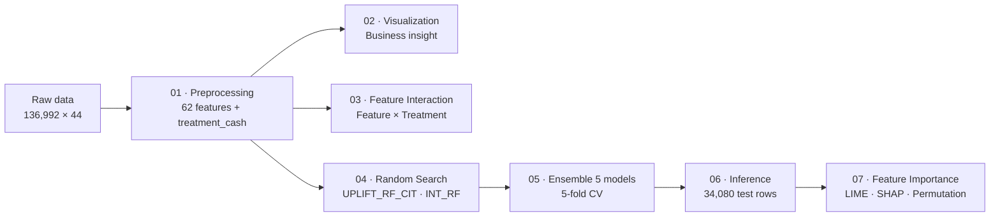
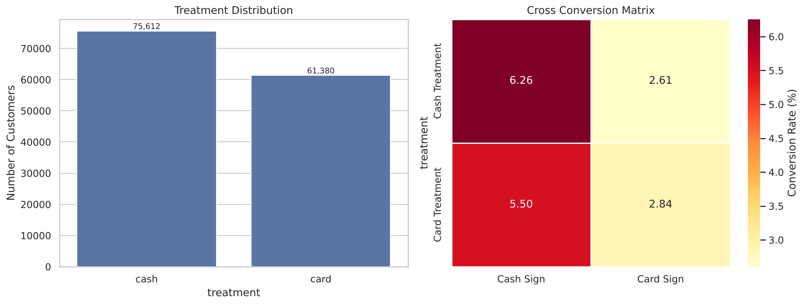
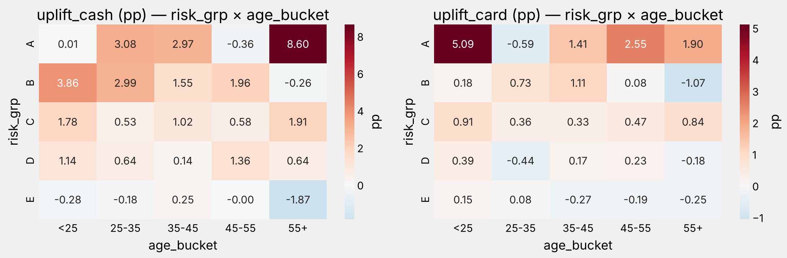

<div align="center">

# 🏦 DAZONE 2026 · Round 3.1 — Home Credit Uplift Modeling

### Cash Loan hay Credit Card — nên truyền thông sản phẩm nào trước cho từng khách hàng?


</div>

---

## 📌 Mục lục

1. [Bài toán](#-1-bài-toán)
2. [Dữ liệu](#-2-dữ-liệu)
3. [Pipeline](#-3-pipeline)
4. [Data Preprocessing](#-4-data-preprocessing)
5. [Visualization & Business Insight](#-5-visualization--business-insight)
6. [Feature Interaction](#-6-feature-interaction)
7. [Uplift Modelling](#-7-uplift-modelling)
8. [Feature Importance](#-8-feature-importance)
9. [Thử nghiệm & Ablation](#-9-thử-nghiệm--ablation)
10. [Cấu trúc repository](#-10-cấu-trúc-repository)
11. [Cách chạy](#-11-cách-chạy)

---

## 🎯 1. Bài toán

> *"Với từng đối tượng khách hàng, nên truyền thông sản phẩm nào trước (tiền mặt hay thẻ tín dụng) để tối đa hóa hiệu suất chuyển đổi của toàn danh mục?"*

| Thành phần | Định nghĩa |
|---|---|
| **Treatment** | Chiến lược truyền thông được phân bổ **ngẫu nhiên**: `cash` hoặc `card` |
| **Outcome** | `cash_sign_30d` (ký Cash Loan), `card_sign_30d` (mở Credit Card) — không hủy, trong 30 ngày sau treatment |
| **Uplift Cash** | `P(cash_sign_30d = 1 \| Cash, x) − P(cash_sign_30d = 1 \| Card, x)` |
| **Uplift Card** | `P(card_sign_30d = 1 \| Card, x) − P(card_sign_30d = 1 \| Cash, x)` |
| **Metric** | `Qini_total = Qini_cash + Qini_card` |

### Qini Coefficient (đúng như cài đặt trong [`src/metrics.py`](src/metrics.py))

Sắp xếp khách hàng theo uplift dự đoán giảm dần; tại tỷ lệ dân số $\phi = k/N$:

$$Q(\phi) = \frac{\sum_{i \le k} y_i\, w_i}{N_{treatment}} - \frac{\sum_{i \le k} y_i\,(1-w_i)}{N_{control}}$$

$$AUC_{random} = \frac{Q(1)}{2}, \qquad \text{Qini}_{coef} = \frac{AUC_{model} - AUC_{random}}{AUC_{perfect} - AUC_{random}}$$

- `AUC` tính bằng tích phân hình thang trên đường cong `(φ, Q(φ))`.
- `AUC_perfect` là đường Qini của oracle score `w·y − (1−w)·y`.
- Target **cash**: `w = 1` nếu treatment = Cash. Target **card**: `w = 1` nếu treatment = Card.

---

## 📦 2. Dữ liệu

| Tập | Số dòng | Số cột gốc | Ghi chú |
|---|---:|---:|---|
| `data/raw/dazone_sample.csv` | **136,992** | 44 | `customer_id`, `treatment`, 2 target, 40 feature |
| `data/raw/dazone_sample_test.csv` | **34,080** | 44 | Target để trống (ẩn nhãn) |

<table>
<tr>
<td>

**Treatment (train)**

| Treatment | Khách hàng | Tỷ trọng |
|---|---:|---:|
| Cash | 75,612 | 55.19% |
| Card | 61,380 | 44.81% |

</td>
<td>

**Conversion (train)**

| Target | Số dương | Tỷ lệ |
|---|---:|---:|
| `cash_sign_30d` | 8,108 | 5.92% |
| `card_sign_30d` | 3,714 | 2.71% |
| Không chuyển đổi | — | 91.82% |

</td>
</tr>
</table>

**Cross Conversion Matrix (%)** — tác động trung bình (ATE) của chiến lược:

| | Cash Sign | Card Sign |
|---|---:|---:|
| **Cash Treatment** | 6.26 | 2.61 |
| **Card Treatment** | 5.50 | 2.84 |
| **ATE** | **+0.76 pp** (uplift cash) | **+0.24 pp** (uplift card) |

> Uplift trung bình rất nhỏ so với base rate → giá trị nằm ở việc **xếp hạng đúng** khách hàng nhạy cảm với từng chiến lược, không phải dự đoán xác suất chuyển đổi chung.

---

## 🔁 3. Pipeline



| Bước | Notebook | Đầu ra |
|---|---|---|
| Data Preprocessing | [`01_data_preprocessing`](notebooks/01_data_preprocessing.ipynb) | `df_feature.csv`, `df_target.csv`, `test_df_feature.csv`, `transformers.joblib` |
| Visualization | [`02_visualization_business_insight`](notebooks/02_visualization_business_insight.ipynb) | Biểu đồ EDA theo phân khúc |
| Feature Interaction | [`03_feature_interaction`](notebooks/03_feature_interaction.ipynb) | Correlation, uplift theo phân khúc, heatmap 2 chiều |
| Uplift Modelling | [`04_uplift_random_search`](notebooks/04_uplift_random_search.ipynb) | `results/random_search_*.csv` |
| Ensemble CV | [`05_ensemble_cross_validation`](notebooks/05_ensemble_cross_validation.ipynb) | `results/ensemble_cv_qini.csv`, Qini curve |
| Inference | [`06_inference_test`](notebooks/06_inference_test.ipynb) | Xác suất + uplift + chiến lược khuyến nghị |
| Feature Importance | [`07_feature_importance`](notebooks/07_feature_importance.ipynb) | `feature_importance.csv` |

---

## 🧹 4. Data Preprocessing

**Loại bỏ 6 cột missing > 50%** và `customer_id`:

| Cột | Missing |
|---|---:|
| `cnt_month_from_first_transaction` | 93.60% |
| `cnt_month_from_last_transaction` | 93.60% |
| `ratio_vol_hcvn_cash_appl_12m` | 89.47% |
| `ratio_monthly_amt_l6m_vs_n6m` | 82.55% |
| `max_cntr_len_fi_12m` | 74.07% |
| `f_appointment_3m` | 55.70% |

**Biến đổi** (fit trên train, áp dụng lại cho test):

| Nhóm | Số cột | Pipeline |
|---|---:|---|
| Số liên tục | 15 | `SimpleImputer(median)` → `MinMaxScaler` |
| Số rời rạc / flag | 12 | `SimpleImputer(most_frequent)` → `MinMaxScaler` |
| Nominal | 7 | `SimpleImputer(most_frequent)` → `OneHotEncoder(drop="first")` → 35 cột (gồm `treatment_cash`) |
| Ordinal `cli_education` | 1 | `SimpleImputer(most_frequent)` → `OrdinalEncoder(ELEMENTARY_SCHOOL < PTCS < PTTH < BACHELORS < MASTERS)` → `MinMaxScaler` |

➡️ `df_feature`: **136,992 × 63** (62 feature trong `[0, 1]` + `treatment_cash`), `df_target`: `cash_sign_30d`, `card_sign_30d`.

---

## 📊 5. Visualization & Business Insight

`cash_minus_card` = *(Cash Treatment → cash_sign_30d)* − *(Card Treatment → card_sign_30d)*, đơn vị điểm %.

<p align="center">

</p>

| Phân khúc | Quan sát | Số liệu |
|---|---|---|
| **Risk group** | Rủi ro càng cao, conversion càng giảm ở cả hai sản phẩm | A: Cash 13.76% / Card 6.70% → E: 2.20% / 1.05% |
| **Số lần thanh toán** | Conversion tăng gần như đơn điệu theo decile | Cash 1.51% (D1) → 18.11% (D10); Card 0.99% → 5.93% |
| **Tất toán khoản vay 12m** | Khách tất toán nhiều khoản phản ứng rất mạnh với Cash | Cash 7.46% (0 khoản) → 26.35% (4+ khoản, n = 260) |
| **Hạn mức offer** | Decile cao nhất có conversion cao nhất | D10: Cash 13.04% / Card 6.30% |
| **Học vấn** | Card cạnh tranh tốt hơn ở nhóm học vấn cao | `cash_minus_card`: PTTH 4.03 → MASTERS 1.98; Card MASTERS 4.78% |
| **Tuổi** | Nhóm <25 có tỷ lệ mở Card cao nhất | Card <25: 4.47%; nhóm 55+ chênh lệch lớn nhất 6.60 |
| **Worst credit status** | Status 3 là nhóm duy nhất Card > Cash | Cash 1.01% / Card 1.39% (n = 171) |
| **Đặt lịch hẹn 3m** | Cash rất cao nhưng mẫu cực nhỏ | Cash 48.28% / Card 4.00% (chỉ 54 khách có flag = 1) |
| **Telesales kết nối** | Tăng từ D1 đến D5 rồi đi ngang | Cash 4.99% (D1) → 6.93% (D5), sau đó 6.03–6.61% |

<p align="center">


</p>

> ⚠️ Các nhóm `risk_grp` F/G/H/I chỉ có 69/13/5/4 khách — tỷ lệ chuyển đổi ở đây không đủ tin cậy.

---

## 🔗 6. Feature Interaction

### 6.1 Feature × Feature — các cặp |corr| ≥ 0.7

| Feature 1 | Feature 2 | corr |
|---|---|---:|
| `cnt_month_from_first_transaction` | `cnt_month_from_last_transaction` | 0.84 |
| `min_sign_vol` | `avg_sign_vol` | 0.75 |
| `cnt_month_from_last_appl` | `cnt_month_from_first_transaction` | 0.73 |
| `cnt_month_from_last_appl` | `cnt_month_from_last_transaction` | 0.71 |

### 6.2 Feature × Treatment — uplift thực sự theo phân khúc

Do treatment được phân bổ ngẫu nhiên, uplift của từng phân khúc được ước lượng trực tiếp bằng chênh lệch hai nhánh. Mức tương tác của feature = độ lệch chuẩn có trọng số của uplift giữa các bin (chỉ giữ bin ≥ 200 khách mỗi nhánh).

<p align="center">

</p>

| Phân khúc | `uplift_cash` (pp) | `uplift_card` (pp) |
|---|---:|---:|
| `cnt_month_from_last_appl` ≤ 6 tháng | **+4.43** | +0.74 |
| `cnt_month_from_last_appl` 6–19 tháng | +2.03 / +2.03 | +0.33 / −0.02 |
| `cnt_month_from_last_appl` > 28 tháng | −0.52 … +0.18 | −0.09 … +0.49 |
| `risk_grp` A / B | +2.42 / +2.30 | +1.07 / +0.66 |
| `risk_grp` E | −0.07 | −0.04 |
| `cnt_total_payment` D9 / D10 | +2.79 / +3.39 | +0.35 / +0.85 |
| `cnt_total_payment` D1–D6 | −0.22 … +0.38 | −0.12 … +0.28 |

> 💡 **Insight:** uplift của chiến lược Cash tập trung ở khách **vừa nộp hồ sơ gần đây**, **rủi ro thấp (A/B)** và **thanh toán nhiều**; ở nhóm rủi ro E hoặc lâu không nộp hồ sơ, truyền thông Cash gần như không tạo thêm chuyển đổi. `cnt_month_from_last_appl` cũng là feature quan trọng nhất của mô hình (mục 8).

<p align="center">

</p>

### 6.3 Ma trận tương tác của INT_RF

$$X_{aug} = [\,X,\; W,\; X \cdot W\,] \in \mathbb{R}^{n \times 125}, \qquad \text{uplift}(x) = \hat P(y=1 \mid x, W=1) - \hat P(y=1 \mid x, W=0)$$

---

## 🤖 7. Uplift Modelling

### 7.1 Sàng lọc learner × base model × direct uplift

| Meta-learner | Base model | Direct uplift (tree) | Direct uplift (forest) |
|---|---|---|---|
| T, S, INT, CT, TO, X, R, DR | dt, rf, extratrees, adaboost, lgbm, xgb, cat, hgb, logistic, knn, fuzzy_knn, svm, mlp, kan, deep_kan | UPLIFT_TREE_{KL, ED, CHI, CTS, DDP}, INTERACTION_TREE, CAUSAL_INFERENCE_TREE | UPLIFT_RF_{KL, ED, CHI, CTS, DDP, IT, CIT}, UTBOOST |

<details>
<summary><b>Top 10 / 40 tổ hợp theo Qini_total</b> (nguồn: <code>docs/report.pdf</code>, Bảng 6)</summary>

| # | Model | Qini cash | Qini card | Qini total |
|---:|---|---:|---:|---:|
| 1 | **INT_RF** | +0.05424 | +0.03991 | **+0.09415** |
| 2 | **UPLIFT_RF_CIT** | +0.05721 | +0.03251 | **+0.08972** |
| 3 | INT_EXTRATREES | +0.04963 | +0.02785 | +0.07748 |
| 4 | TO_KAN | +0.05628 | +0.01970 | +0.07598 |
| 5 | UPLIFT_TREE_CIT | +0.05575 | +0.01855 | +0.07430 |
| 6 | DR_SVM | +0.04458 | +0.02937 | +0.07395 |
| 7 | TO_RF | +0.05829 | +0.01354 | +0.07183 |
| 8 | UPLIFT_RF_IT | +0.05722 | +0.01402 | +0.07124 |
| 9 | TO_LOGISTIC | +0.04885 | +0.02201 | +0.07086 |
| 10 | UPLIFT_RF_KL | +0.05637 | +0.01311 | +0.06948 |

</details>

➡️ Hai model được tối ưu tiếp: **INT_RF** (Interaction S-Learner + Random Forest) và **UPLIFT_RF_CIT** (CausalML Uplift Random Forest, `evaluationFunction="CIT"`).

### 7.2 Random Search (OOF 5-fold, fold riêng cho từng target)

<table>
<tr>
<td valign="top">

**UPLIFT_RF_CIT** — 30 cấu hình

| Cấu hình | n | depth | leaf | treat | mf_cap | Qini total |
|---|---:|---:|---:|---:|---:|---:|
| ✅ CFG028 | 80 | 8 | 120 | 20 | 32 | **0.107228** |
| CFG019 | 60 | 8 | 220 | 30 | 16 | 0.101231 |
| ✅ CFG009 | 120 | 5 | 80 | 30 | 32 | 0.099346 |
| ✅ CFG011 | 120 | 5 | 160 | 40 | 32 | 0.099099 |
| CFG014 | 220 | 5 | 160 | 30 | 20 | 0.094458 |

</td>
<td valign="top">

**INT_RF** — 40 cấu hình

| Cấu hình | n | depth | leaf | split | mf | crit | cw | Qini total |
|---|---:|---:|---:|---:|---|---|---|---:|
| RS_040 | 180 | 6 | 160 | 20 | 0.75 | entropy | None | 0.098835 |
| RS_001 | 320 | 9 | 80 | 2 | sqrt | gini | bal_sub | 0.094145 |
| RS_034 | 420 | 8 | 120 | 20 | log2 | gini | None | 0.091325 |
| ✅ RS_027 | 560 | 6 | 80 | 50 | log2 | entropy | balanced | 0.091053 |
| ✅ RS_028 | 420 | 6 | 30 | 2 | log2 | gini | balanced | 0.090592 |

</td>
</tr>
</table>

- Chi tiết cash/card, toàn bộ tham số và Qini từng fold: [`results/random_search_uplift_rf_cit.csv`](results/random_search_uplift_rf_cit.csv), [`results/random_search_int_rf.csv`](results/random_search_int_rf.csv) và các file `*_folds.csv`.
- 3 cấu hình UPLIFT_RF_CIT được chọn có `qini_card` **dương ở cả 5 fold**; CFG019 có `qini_card` âm ở fold 5 (−0.00107).
- Cấu hình CFG012 (`max_depth=None`) lỗi khi train nên không có điểm.

### 7.3 🏆 Model cuối: Ensemble 3 × UPLIFT_RF_CIT + 2 × INT_RF

$$\text{uplift}_{ensemble}(x) = \frac{1}{5}\sum_{m=1}^{5}\text{uplift}_m(x) \quad \text{(tính riêng cho cash và card)}$$

**5-fold CV** — `StratifiedKFold(5, shuffle=True, random_state=42)` theo `treatment_cash × cash_sign_30d × card_sign_30d`:

| Fold | Qini cash | Qini card | Qini total |
|---|---:|---:|---:|
| 0 | 0.054649 | 0.034239 | 0.088888 |
| 1 | 0.060871 | 0.071237 | **0.132108** |
| 2 | 0.053167 | 0.036965 | 0.090131 |
| 3 | 0.053593 | 0.023256 | 0.076850 |
| 4 | 0.065876 | 0.020799 | 0.086675 |
| **Mean 5-fold** | **0.057631** | **0.037299** | **0.094930** |

<p align="center">


</p>
<p align="center"><i>Qini curve của fold tốt nhất (fold 1)</i></p>

<details>
<summary><b>Qini in-sample sau khi fit trên toàn bộ train</b> (không phải điểm validation)</summary>

| Model | Qini cash | Qini card | Qini total |
|---|---:|---:|---:|
| CFG028_UPLIFT_RF_CIT | 0.134977 | 0.232503 | 0.367480 |
| CFG009_UPLIFT_RF_CIT | 0.068274 | 0.069925 | 0.138199 |
| CFG011_UPLIFT_RF_CIT | 0.068305 | 0.069816 | 0.138122 |
| INT_RF_RS_027 | 0.088286 | 0.144436 | 0.232722 |
| INT_RF_RS_028 | 0.091589 | 0.167941 | 0.259530 |
| **Ensemble** | 0.088185 | 0.158916 | 0.247102 |

</details>

### 7.4 Inference

- Fit lại 5 base model trên 136,992 dòng train, dự đoán 34,080 dòng test.
- Xác suất base model: UPLIFT_RF_CIT dùng `clip(control_rate + uplift, 0, 1)`; INT_RF dùng `P̂(y=1 | x, W=event)`.
- Khuyến nghị: **Cash** nếu `uplift_cash_score − uplift_card_score ≥ 0`, ngược lại **Card**.
- File nộp gốc: [`results/final_submission/submission.csv`](results/final_submission/submission.csv) (xác suất của 5 base model).

---

## 🧭 8. Feature Importance

$$FI^{(k)}_j = \frac{1}{5}\sum_{m=1}^{5} FI^{(k)}_{j,m}, \quad k \in \{lime, shap, permutation\} \qquad FI^{final}_j = \frac{FI^{(lime)}_j + FI^{(shap)}_j + FI^{(permutation)}_j}{3}$$

- **LIME** / **SHAP (KernelExplainer)**: trung bình trị tuyệt đối đóng góp vào uplift score, lấy trung bình cash & card.
- **Permutation**: mức giảm `Qini_cash + Qini_card` khi hoán vị feature (800 dòng train, 3 lần lặp).

<p align="center">

</p>

| # | Feature | LIME | SHAP | Permutation | **FI final** |
|---:|---|---:|---:|---:|---:|
| 1 | `cnt_month_from_last_appl` | 0.009252 | 0.007944 | 0.113435 | **0.043544** |
| 2 | `cnt_report_institution_12m` | 0.006752 | 0.002000 | 0.090472 | **0.033074** |
| 3 | `cli_emp_period` | 0.001958 | 0.001191 | 0.034610 | **0.012586** |
| 4 | `cli_age` | 0.001285 | 0.000690 | 0.034755 | **0.012243** |
| 5 | `last_offer_limit` | 0.002552 | 0.001004 | 0.032710 | **0.012089** |
| 6 | `last_process_channel_D` | 0.000000 | 0.000270 | 0.031456 | **0.010575** |
| 7 | `cnt_fi_inst_appl_12m` | 0.007850 | 0.001796 | 0.007634 | **0.005760** |
| 8 | `risk_grp_E` | 0.003746 | 0.001023 | 0.012019 | **0.005596** |
| 9 | `cli_marital_status_Married` | 0.000000 | 0.000108 | 0.015802 | **0.005303** |
| 10 | `risk_grp_C` | 0.000584 | 0.000161 | 0.012952 | **0.004566** |

> Permutation importance (đơn vị Qini) có độ lớn vượt trội LIME/SHAP (đơn vị uplift) nên chi phối `FI final`. Đầy đủ 62 feature và từng model: [`results/final_submission/feature_importance/`](results/final_submission/feature_importance).

---

## 🧪 9. Thử nghiệm & Ablation

Các hướng nghiên cứu được tích hợp lên INT_RF / UPLIFT_RF_CIT (cấu hình baseline), **không được dùng trong model cuối**. Qini OOF 5-fold:

| Paper | Model | Qini cash | Qini card | Qini total |
|---|---|---:|---:|---:|
| *Baseline* | INT_RF (RS_001) | 0.054236 | 0.039909 | 0.094145 |
| *Baseline* | UPLIFT_RF_CIT (CFG001) | 0.057206 | 0.032514 | 0.089720 |
| Feature Selection for Uplift (Zhao et al.) — Chi filter | CHI_FS_INT_RF | 0.058476 | 0.039081 | 0.097557 ¹ |
| CAFE — Causally-Guided Automated Feature Engineering | CAFE_UPLIFT_RF_CIT | 0.057509 | 0.034297 | 0.091806 |
| CAFE | CAFE_INT_RF | 0.055961 | 0.032946 | 0.088907 |
| EFIN — Explicit Feature Interaction-aware Uplift Network | EFIN_UPLIFT_RF_CIT | 0.055012 | 0.029427 | 0.084439 |
| EFIN | EFIN_INT_RF | 0.024991 | 0.019882 | 0.044873 |
| Class Flipping on imbalanced RCT data | CLASS_FLIP_INT_RF | 0.051609 | 0.012721 | 0.064329 |
| Class Flipping | CLASS_FLIP_UPLIFT_RF_CIT | 0.042424 | 0.013428 | 0.055852 |
| RUAD — Adversarial Feature Desensitization | RUAD_SNN | 0.034764 | 0.016639 | 0.051403 |

¹ Nhánh UPLIFT_RF_CIT của notebook này dừng ở fold 2, không có điểm cuối.

| Nhóm | Notebook | Trạng thái |
|---|---|---|
| Paper integration | [`experiments/paper_integration/`](experiments/paper_integration) | Có log kết quả (bảng trên) |
| Biến thể model: Spline KAN, Deep KAN, TabNet, Multi-head PTONet + Qini loss, ML/CausalML/UTBoost grid | [`experiments/model_variations/`](experiments/model_variations) | Notebook không lưu output |

---

## 🗂 10. Cấu trúc repository

```
.
├── README.md
├── requirements.txt
├── src/
│   ├── config.py           # đường dẫn, nhóm cột, không gian tìm kiếm, cấu hình model cuối
│   ├── preprocessing.py    # load, fit/transform, ma trận model
│   ├── analysis.py         # bảng conversion, uplift theo phân khúc, interaction score
│   ├── metrics.py          # Qini curve & Qini coefficient
│   ├── models.py           # INT_RF, UPLIFT_RF_CIT
│   ├── search.py           # random search + CV theo target
│   ├── ensemble.py         # ensemble 5 model, CV, full-train inference
│   ├── explain.py          # Qini in-sample, LIME, SHAP, permutation importance
│   └── plots.py
├── notebooks/              # 01 → 07 theo thứ tự pipeline
├── data/
│   ├── raw/                # dazone_sample.csv, dazone_sample_test.csv
│   └── processed/          # df_feature.csv, df_target.csv, test_df_feature.csv, transformers.joblib
├── results/
│   ├── final_submission/   # submission.csv + feature_importance/ (bản nộp)
│   ├── figures/
│   ├── random_search_*.csv
│   ├── ensemble_cv_qini.csv
│   ├── train_qini_full_fit.csv
│   └── experiments_summary.csv
├── experiments/            # thử nghiệm / ablation
├── archive/                # notebook gốc (kèm log chạy Kaggle), file zip nộp bài, output phiên bản sớm
└── docs/                   # đề bài, mô tả dữ liệu, report.pdf
```

---

## ▶️ 11. Cách chạy

```bash
pip install -r requirements.txt
```

```bash
jupyter notebook notebooks/
```

Chạy lần lượt `01` → `07`. Notebook `04` (≈ 650 + 576 phút trên Kaggle CPU 4 core) và `05`–`07` tốn nhiều thời gian; kết quả tham chiếu đã có sẵn trong `results/`.

> **Tái lập:** các số liệu trong `results/` được trích từ log chạy gốc trên Kaggle (`archive/original_notebooks/`). Code trong `src/` giữ nguyên seed, cách chia fold và cách sinh cấu hình của code gốc (30 + 40 cấu hình random search sinh lại trùng 100%; INT_RF cho Qini từng fold trùng code gốc khi chạy cùng môi trường). Chạy với phiên bản `scikit-learn` / `causalml` khác bản trên Kaggle có thể lệch nhẹ ở chữ số thập phân thứ 3. `data/processed/df_feature.csv` là đúng file đã dùng để huấn luyện.
