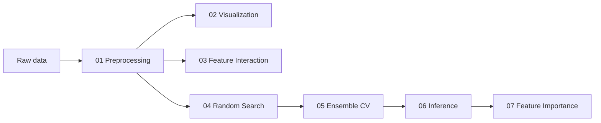
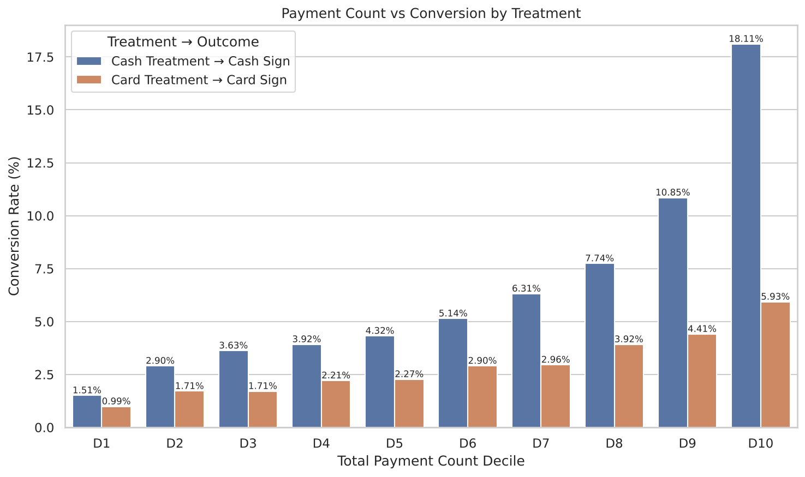

# DAZONE 2026 Round 3.1 - Home Credit Uplift Modeling

Bài toán: với từng khách hàng, nên truyền thông Cash Loan hay Credit Card trước để tối đa hóa chuyển đổi của toàn danh mục.

Mô hình cuối là ensemble 3 cấu hình UPLIFT_RF_CIT và 2 cấu hình INT_RF, đạt Qini_total trung bình 5-fold là 0.094930 (fold tốt nhất 0.132108).

## 1. Bài toán

| Thành phần | Định nghĩa |
|---|---|
| Treatment | Chiến lược truyền thông được phân bổ ngẫu nhiên: `cash` hoặc `card` |
| Outcome | `cash_sign_30d` (ký Cash Loan), `card_sign_30d` (mở Credit Card), không hủy, trong 30 ngày sau treatment |
| Uplift Cash | `P(cash_sign_30d = 1 \| Cash, x) - P(cash_sign_30d = 1 \| Card, x)` |
| Uplift Card | `P(card_sign_30d = 1 \| Card, x) - P(card_sign_30d = 1 \| Cash, x)` |
| Metric | `Qini_total = Qini_cash + Qini_card` |

### Qini Coefficient

Sắp xếp khách hàng theo uplift dự đoán giảm dần. Tại tỷ lệ dân số $\phi = k/N$:

$$Q(\phi) = \frac{\sum_{i \le k} y_i\, w_i}{N_{treatment}} - \frac{\sum_{i \le k} y_i\,(1-w_i)}{N_{control}}$$

$$AUC_{random} = \frac{Q(1)}{2}, \qquad \text{Qini}_{coef} = \frac{AUC_{model} - AUC_{random}}{AUC_{perfect} - AUC_{random}}$$

- AUC tính bằng tích phân hình thang trên đường cong `(φ, Q(φ))`.
- `AUC_perfect` là đường Qini của oracle score `w·y - (1-w)·y`.
- Với target cash, `w = 1` khi treatment là Cash. Với target card, `w = 1` khi treatment là Card.

## 2. Dữ liệu

| Tập | Số dòng | Số cột | Ghi chú |
|---|---:|---:|---|
| `data/raw/dazone_sample.csv` | 136,992 | 44 | `customer_id`, `treatment`, 2 target, 40 feature |
| `data/raw/dazone_sample_test.csv` | 34,080 | 44 | Đã ẩn nhãn |

| Treatment | Khách hàng | Tỷ trọng |
|---|---:|---:|
| Cash | 75,612 | 55.19% |
| Card | 61,380 | 44.81% |

| Target | Số dương | Tỷ lệ |
|---|---:|---:|
| `cash_sign_30d` | 8,108 | 5.92% |
| `card_sign_30d` | 3,714 | 2.71% |
| Không chuyển đổi | | 91.82% |

Tỷ lệ chuyển đổi theo treatment (%):

| | Cash Sign | Card Sign |
|---|---:|---:|
| Cash Treatment | 6.26 | 2.61 |
| Card Treatment | 5.50 | 2.84 |
| Chênh lệch (ATE) | +0.76 pp | +0.24 pp |

Uplift trung bình rất nhỏ so với base rate, nên mục tiêu là xếp hạng đúng những khách hàng phản ứng với từng chiến lược chứ không phải dự đoán xác suất chuyển đổi chung.

## 3. Pipeline



| Bước | Notebook | Đầu ra |
|---|---|---|
| Data Preprocessing | [01_data_preprocessing](notebooks/01_data_preprocessing.ipynb) | `df_feature.csv`, `df_target.csv`, `test_df_feature.csv`, `transformers.joblib` |
| Visualization | [02_visualization_business_insight](notebooks/02_visualization_business_insight.ipynb) | Biểu đồ EDA theo phân khúc |
| Feature Interaction | [03_feature_interaction](notebooks/03_feature_interaction.ipynb) | Correlation, uplift theo phân khúc |
| Random Search | [04_uplift_random_search](notebooks/04_uplift_random_search.ipynb) | `results/random_search_*.csv` |
| Ensemble CV | [05_ensemble_cross_validation](notebooks/05_ensemble_cross_validation.ipynb) | `results/ensemble_cv_qini.csv`, Qini curve |
| Inference | [06_inference_test](notebooks/06_inference_test.ipynb) | Xác suất, uplift, chiến lược khuyến nghị |
| Feature Importance | [07_feature_importance](notebooks/07_feature_importance.ipynb) | `feature_importance.csv` |

## 4. Data Preprocessing

Bỏ `customer_id` và 6 cột thiếu trên 50%:

| Cột | Missing |
|---|---:|
| `cnt_month_from_first_transaction` | 93.60% |
| `cnt_month_from_last_transaction` | 93.60% |
| `ratio_vol_hcvn_cash_appl_12m` | 89.47% |
| `ratio_monthly_amt_l6m_vs_n6m` | 82.55% |
| `max_cntr_len_fi_12m` | 74.07% |
| `f_appointment_3m` | 55.70% |

Các transformer được fit trên train rồi dùng lại cho test:

| Nhóm | Số cột | Xử lý |
|---|---:|---|
| Số liên tục | 15 | `SimpleImputer(median)`, `MinMaxScaler` |
| Số rời rạc, flag | 12 | `SimpleImputer(most_frequent)`, `MinMaxScaler` |
| Nominal | 7 | `SimpleImputer(most_frequent)`, `OneHotEncoder(drop="first")`, ra 35 cột (gồm `treatment_cash`) |
| Ordinal `cli_education` | 1 | `SimpleImputer(most_frequent)`, `OrdinalEncoder` theo thứ tự ELEMENTARY_SCHOOL, PTCS, PTTH, BACHELORS, MASTERS, `MinMaxScaler` |

Kết quả: `df_feature` có 136,992 dòng, 63 cột (62 feature trong khoảng [0, 1] và `treatment_cash`); `df_target` gồm `cash_sign_30d`, `card_sign_30d`.

## 5. Visualization và Business Insight

`cash_minus_card` là tỷ lệ ký Cash ở nhóm Cash Treatment trừ tỷ lệ mở Card ở nhóm Card Treatment, đơn vị điểm %.


| Phân khúc | Nhận xét | Số liệu |
|---|---|---|
| Risk group | Rủi ro càng cao thì chuyển đổi càng thấp ở cả hai sản phẩm | A: Cash 13.76%, Card 6.70%; E: Cash 2.20%, Card 1.05% |
| Số lần thanh toán | Chuyển đổi tăng gần như đều theo decile | Cash 1.51% (D1) lên 18.11% (D10); Card 0.99% lên 5.93% |
| Tất toán khoản vay 12 tháng | Khách tất toán nhiều khoản phản ứng mạnh với Cash | Cash 7.46% (0 khoản), 26.35% (4 khoản trở lên, n = 260) |
| Hạn mức offer | Decile cao nhất có chuyển đổi cao nhất | D10: Cash 13.04%, Card 6.30% |
| Học vấn | Card cạnh tranh tốt hơn ở nhóm học vấn cao | `cash_minus_card` PTTH 4.03, MASTERS 1.98; Card ở MASTERS 4.78% |
| Tuổi | Nhóm dưới 25 tuổi mở Card nhiều nhất | Card 4.47%; nhóm 55+ có chênh lệch lớn nhất 6.60 |
| Worst credit status | Status 3 là nhóm duy nhất Card cao hơn Cash | Cash 1.01%, Card 1.39% (n = 171) |
| Đặt lịch hẹn 3 tháng | Cash rất cao nhưng mẫu quá nhỏ | Cash 48.28%, Card 4.00% (54 khách) |
| Telesales kết nối | Tăng từ D1 đến D5 rồi đi ngang | Cash 4.99% (D1), 6.93% (D5), sau đó 6.03% đến 6.61% |

 

Các nhóm `risk_grp` F, G, H, I chỉ có 69, 13, 5, 4 khách nên tỷ lệ ở các nhóm này không đáng tin.

## 6. Feature Interaction

### 6.1 Tương quan giữa các feature (|corr| ≥ 0.7)

| Feature 1 | Feature 2 | corr |
|---|---|---:|
| `cnt_month_from_first_transaction` | `cnt_month_from_last_transaction` | 0.84 |
| `min_sign_vol` | `avg_sign_vol` | 0.75 |
| `cnt_month_from_last_appl` | `cnt_month_from_first_transaction` | 0.73 |
| `cnt_month_from_last_appl` | `cnt_month_from_last_transaction` | 0.71 |

### 6.2 Tương tác giữa feature và treatment

Vì treatment được phân bổ ngẫu nhiên nên uplift của từng phân khúc có thể ước lượng bằng chênh lệch tỷ lệ giữa hai nhóm. Mức tương tác của một feature được đo bằng độ lệch chuẩn có trọng số của uplift giữa các bin, chỉ giữ bin có từ 200 khách mỗi nhóm trở lên.


| Phân khúc | `uplift_cash` (pp) | `uplift_card` (pp) |
|---|---:|---:|
| `cnt_month_from_last_appl` ≤ 6 tháng | +4.43 | +0.74 |
| `cnt_month_from_last_appl` 6 đến 19 tháng | +2.03 / +2.03 | +0.33 / -0.02 |
| `cnt_month_from_last_appl` > 28 tháng | -0.52 đến +0.18 | -0.09 đến +0.49 |
| `risk_grp` A / B | +2.42 / +2.30 | +1.07 / +0.66 |
| `risk_grp` E | -0.07 | -0.04 |
| `cnt_total_payment` D9 / D10 | +2.79 / +3.39 | +0.35 / +0.85 |
| `cnt_total_payment` D1 đến D6 | -0.22 đến +0.38 | -0.12 đến +0.28 |

Uplift của chiến lược Cash tập trung ở khách vừa nộp hồ sơ gần đây, rủi ro thấp (A, B) và thanh toán nhiều. Với nhóm rủi ro E hoặc đã lâu không nộp hồ sơ, truyền thông Cash gần như không tạo thêm chuyển đổi. `cnt_month_from_last_appl` cũng là feature quan trọng nhất của mô hình (mục 8).


### 6.3 Ma trận đầu vào của INT_RF

$$X_{aug} = [\,X,\; W,\; X \cdot W\,] \in \mathbb{R}^{n \times 125}, \qquad \text{uplift}(x) = \hat P(y=1 \mid x, W=1) - \hat P(y=1 \mid x, W=0)$$

## 7. Uplift Modelling

### 7.1 Sàng lọc model

| Meta-learner | Base model | Direct uplift (tree) | Direct uplift (forest) |
|---|---|---|---|
| T, S, INT, CT, TO, X, R, DR | dt, rf, extratrees, adaboost, lgbm, xgb, cat, hgb, logistic, knn, fuzzy_knn, svm, mlp, kan, deep_kan | UPLIFT_TREE_{KL, ED, CHI, CTS, DDP}, INTERACTION_TREE, CAUSAL_INFERENCE_TREE | UPLIFT_RF_{KL, ED, CHI, CTS, DDP, IT, CIT}, UTBOOST |

Top 10 theo Qini_total (lấy từ Bảng 6 trong `docs/report.pdf`):

| # | Model | Qini cash | Qini card | Qini total |
|---:|---|---:|---:|---:|
| 1 | INT_RF | +0.05424 | +0.03991 | +0.09415 |
| 2 | UPLIFT_RF_CIT | +0.05721 | +0.03251 | +0.08972 |
| 3 | INT_EXTRATREES | +0.04963 | +0.02785 | +0.07748 |
| 4 | TO_KAN | +0.05628 | +0.01970 | +0.07598 |
| 5 | UPLIFT_TREE_CIT | +0.05575 | +0.01855 | +0.07430 |
| 6 | DR_SVM | +0.04458 | +0.02937 | +0.07395 |
| 7 | TO_RF | +0.05829 | +0.01354 | +0.07183 |
| 8 | UPLIFT_RF_IT | +0.05722 | +0.01402 | +0.07124 |
| 9 | TO_LOGISTIC | +0.04885 | +0.02201 | +0.07086 |
| 10 | UPLIFT_RF_KL | +0.05637 | +0.01311 | +0.06948 |

Hai model được tối ưu tiếp là INT_RF (Interaction S-Learner với Random Forest) và UPLIFT_RF_CIT (CausalML Uplift Random Forest, `evaluationFunction="CIT"`).

### 7.2 Random Search

Điểm là Qini OOF 5-fold, mỗi target dùng bộ fold riêng. Dấu `*` là cấu hình được chọn vào ensemble.

UPLIFT_RF_CIT, 30 cấu hình:

| Cấu hình | n | depth | leaf | treat | mf_cap | Qini total |
|---|---:|---:|---:|---:|---:|---:|
| CFG028 * | 80 | 8 | 120 | 20 | 32 | 0.107228 |
| CFG019 | 60 | 8 | 220 | 30 | 16 | 0.101231 |
| CFG009 * | 120 | 5 | 80 | 30 | 32 | 0.099346 |
| CFG011 * | 120 | 5 | 160 | 40 | 32 | 0.099099 |
| CFG014 | 220 | 5 | 160 | 30 | 20 | 0.094458 |

INT_RF, 40 cấu hình:

| Cấu hình | n | depth | leaf | split | max_features | criterion | class_weight | Qini total |
|---|---:|---:|---:|---:|---|---|---|---:|
| RS_040 | 180 | 6 | 160 | 20 | 0.75 | entropy | None | 0.098835 |
| RS_001 | 320 | 9 | 80 | 2 | sqrt | gini | balanced_subsample | 0.094145 |
| RS_034 | 420 | 8 | 120 | 20 | log2 | gini | None | 0.091325 |
| RS_027 * | 560 | 6 | 80 | 50 | log2 | entropy | balanced | 0.091053 |
| RS_028 * | 420 | 6 | 30 | 2 | log2 | gini | balanced | 0.090592 |

- Kết quả đầy đủ (cash, card, tham số, từng fold) nằm trong `results/random_search_uplift_rf_cit.csv`, `results/random_search_int_rf.csv` và các file `*_folds.csv`.
- Ba cấu hình UPLIFT_RF_CIT được chọn có `qini_card` dương ở cả 5 fold, còn CFG019 bị âm ở fold 5 (-0.00107).
- CFG012 (`max_depth=None`) bị lỗi khi train nên không có điểm.

### 7.3 Model cuối: Ensemble 3 UPLIFT_RF_CIT + 2 INT_RF

$$\text{uplift}_{ensemble}(x) = \frac{1}{5}\sum_{m=1}^{5}\text{uplift}_m(x)$$

Tính riêng cho cash và card. Đánh giá bằng `StratifiedKFold(5, shuffle=True, random_state=42)`, stratify theo `treatment_cash`, `cash_sign_30d`, `card_sign_30d`:

| Fold | Qini cash | Qini card | Qini total |
|---|---:|---:|---:|
| 0 | 0.054649 | 0.034239 | 0.088888 |
| 1 | 0.060871 | 0.071237 | 0.132108 |
| 2 | 0.053167 | 0.036965 | 0.090131 |
| 3 | 0.053593 | 0.023256 | 0.076850 |
| 4 | 0.065876 | 0.020799 | 0.086675 |
| Trung bình | 0.057631 | 0.037299 | 0.094930 |

Qini curve của fold 1:

 

Qini trên chính tập train sau khi fit toàn bộ (in-sample, không dùng để so sánh model):

| Model | Qini cash | Qini card | Qini total |
|---|---:|---:|---:|
| CFG028_UPLIFT_RF_CIT | 0.134977 | 0.232503 | 0.367480 |
| CFG009_UPLIFT_RF_CIT | 0.068274 | 0.069925 | 0.138199 |
| CFG011_UPLIFT_RF_CIT | 0.068305 | 0.069816 | 0.138122 |
| INT_RF_RS_027 | 0.088286 | 0.144436 | 0.232722 |
| INT_RF_RS_028 | 0.091589 | 0.167941 | 0.259530 |
| Ensemble | 0.088185 | 0.158916 | 0.247102 |

### 7.4 Inference

- Fit lại 5 model trên toàn bộ 136,992 dòng train và dự đoán 34,080 dòng test.
- Xác suất của UPLIFT_RF_CIT là `clip(control_rate + uplift, 0, 1)`, của INT_RF là `P(y=1 | x, W=event)`.
- Khuyến nghị Cash nếu `uplift_cash_score - uplift_card_score ≥ 0`, ngược lại là Card.
- File đã nộp: `results/final_submission/submission.csv` (xác suất của 5 base model).

## 8. Feature Importance

$$FI^{(k)}_j = \frac{1}{5}\sum_{m=1}^{5} FI^{(k)}_{j,m}, \quad k \in \{lime, shap, permutation\} \qquad FI^{final}_j = \frac{FI^{(lime)}_j + FI^{(shap)}_j + FI^{(permutation)}_j}{3}$$

- LIME và SHAP (KernelExplainer): trung bình trị tuyệt đối đóng góp vào uplift score, lấy trung bình giữa cash và card.
- Permutation: mức giảm `Qini_cash + Qini_card` khi hoán vị feature, tính trên 800 dòng train, lặp 3 lần.


| # | Feature | LIME | SHAP | Permutation | FI final |
|---:|---|---:|---:|---:|---:|
| 1 | `cnt_month_from_last_appl` | 0.009252 | 0.007944 | 0.113435 | 0.043544 |
| 2 | `cnt_report_institution_12m` | 0.006752 | 0.002000 | 0.090472 | 0.033074 |
| 3 | `cli_emp_period` | 0.001958 | 0.001191 | 0.034610 | 0.012586 |
| 4 | `cli_age` | 0.001285 | 0.000690 | 0.034755 | 0.012243 |
| 5 | `last_offer_limit` | 0.002552 | 0.001004 | 0.032710 | 0.012089 |
| 6 | `last_process_channel_D` | 0.000000 | 0.000270 | 0.031456 | 0.010575 |
| 7 | `cnt_fi_inst_appl_12m` | 0.007850 | 0.001796 | 0.007634 | 0.005760 |
| 8 | `risk_grp_E` | 0.003746 | 0.001023 | 0.012019 | 0.005596 |
| 9 | `cli_marital_status_Married` | 0.000000 | 0.000108 | 0.015802 | 0.005303 |
| 10 | `risk_grp_C` | 0.000584 | 0.000161 | 0.012952 | 0.004566 |

Permutation (đơn vị Qini) lớn hơn nhiều so với LIME và SHAP (đơn vị uplift) nên chiếm phần lớn trong FI final. Bảng đầy đủ 62 feature và từng model nằm trong `results/final_submission/feature_importance/`.

## 9. Thử nghiệm khác

Các hướng dưới đây được thử trên INT_RF và UPLIFT_RF_CIT với cấu hình baseline nhưng không dùng trong model cuối. Điểm là Qini OOF 5-fold.

| Paper | Model | Qini cash | Qini card | Qini total |
|---|---|---:|---:|---:|
| Baseline | INT_RF (RS_001) | 0.054236 | 0.039909 | 0.094145 |
| Baseline | UPLIFT_RF_CIT (CFG001) | 0.057206 | 0.032514 | 0.089720 |
| Feature Selection for Uplift (Zhao et al.), Chi filter | CHI_FS_INT_RF | 0.058476 | 0.039081 | 0.097557 |
| CAFE | CAFE_UPLIFT_RF_CIT | 0.057509 | 0.034297 | 0.091806 |
| CAFE | CAFE_INT_RF | 0.055961 | 0.032946 | 0.088907 |
| EFIN | EFIN_UPLIFT_RF_CIT | 0.055012 | 0.029427 | 0.084439 |
| EFIN | EFIN_INT_RF | 0.024991 | 0.019882 | 0.044873 |
| Class Flipping | CLASS_FLIP_INT_RF | 0.051609 | 0.012721 | 0.064329 |
| Class Flipping | CLASS_FLIP_UPLIFT_RF_CIT | 0.042424 | 0.013428 | 0.055852 |
| RUAD | RUAD_SNN | 0.034764 | 0.016639 | 0.051403 |

Notebook Chi filter chưa chạy xong nhánh UPLIFT_RF_CIT (dừng ở fold 2). Các notebook trong `experiments/model_variations/` (Spline KAN, Deep KAN, TabNet, Multi-head PTONet, grid ML/CausalML/UTBoost) không lưu output.

## 10. Cấu trúc thư mục

```
.
├── src/
│   ├── config.py
│   ├── preprocessing.py
│   ├── analysis.py
│   ├── metrics.py
│   ├── models.py
│   ├── search.py
│   ├── ensemble.py
│   ├── explain.py
│   └── plots.py
├── notebooks/            01 đến 07
├── data/
│   ├── raw/
│   └── processed/
├── results/
│   ├── final_submission/
│   ├── figures/
│   └── *.csv
├── experiments/
├── archive/              notebook gốc chạy trên Kaggle, file zip nộp bài
└── docs/                 đề bài, mô tả dữ liệu, report.pdf
```

## 11. Cách chạy

```bash
pip install -r requirements.txt
```

```bash
jupyter notebook notebooks/
```

Chạy lần lượt từ 01 đến 07. Notebook 04 mất khoảng 650 phút (UPLIFT_RF_CIT) và 576 phút (INT_RF) trên Kaggle CPU 4 core, các notebook 05 đến 07 cũng khá lâu. Kết quả đã có sẵn trong `results/`, lấy từ log chạy trên Kaggle (`archive/original_notebooks/`). Chạy lại với phiên bản `scikit-learn` hoặc `causalml` khác có thể lệch nhẹ ở chữ số thập phân thứ 3.
